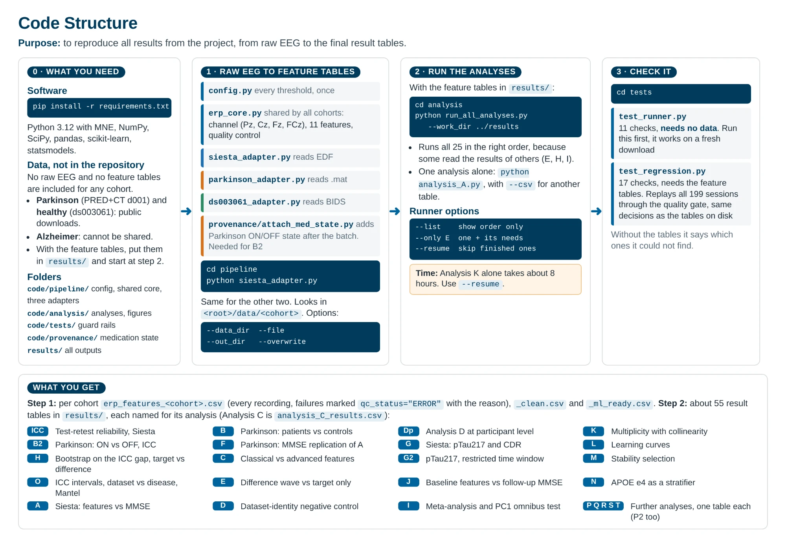

# P300 feature extraction and analysis

Turns raw EEG from three cohorts into one feature table each, measured and
quality-controlled identically, then runs the analyses the thesis reports.



---

## Data availability

The three cohorts are not equally shareable.

| cohort | source | shareable |
|---|---|---|
| Alzheimer | provided by The Siesta Group | **No.** Written non-disclosure agreement. Group statistics only. |
| Parkinson | PRED+CT dataset d001, `predict.cs.unm.edu` | Yes, public |
| healthy | OpenNeuro `ds003061` | Yes, public |

**`results/` holds the computed output of every analysis**, which is what the
tables and figures of Chapter 3 report. It carries no clinical data, no dates,
and nothing at participant level from the Alzheimer cohort.

Two files are the exception to the group-statistic rule and both concern the
public Parkinson cohort. `diag_parkinson_timing.csv` and
`diag_residual_alpha_parkinson.csv` carry one row per recording, keyed by the
subject numbers that cohort's own authors published, and hold nothing but
values measured from the EEG. They are kept because the thesis cites them for
the event-timing check and the alpha-band check.

**The per-recording feature tables, `erp_features_*.csv`, are not included.**
They hold one row per recording with age, sex, CDR, MMSE and genotype attached,
so they fall under the agreement above. They are also the input the analyses
read, which is why `run_all_analyses.py` stops and names them if they are
absent.

> If the feature tables are supplied separately, put them in `results/` and
> everything below runs end to end.

The raw recordings are not included for any cohort. The two public ones can be
downloaded from the sources above.

---

## What is here

```
code/
  pipeline/     config, the shared core, three adapters
  analysis/     the analyses, A to AA, plus the figure scripts
  tests/        guard rails
  provenance/   attaches medication state after a batch
results/        the output of every analysis
```

---

## Running it

```
pip install -r requirements.txt
```

**The analyses.** With the feature tables in `results/`:

```
cd analysis
python run_all_analyses.py --work_dir ../results
```

One analysis at a time runs with no arguments, for example
`python analysis_A.py`. Pass `--csv` to point it at a different table.

**The pipeline**, which needs the raw recordings:

```
cd pipeline
python siesta_adapter.py
python parkinson_adapter.py
python ds003061_adapter.py
```

Each looks for its recordings in `<root>/data/<cohort>`. Pass `--data_dir` for
anywhere else, `--file` for a single recording, `--out_dir` to write elsewhere,
`--overwrite` to replace an existing export.

Nothing is hard-coded to one machine. `config.py` resolves every path from its
own location, walking up to the first folder holding `results/`. Set `P300_ROOT`
or `P300_OUTPUTS` to override.

---

## Reproducing all of it

`run_all_analyses.py` drives 25 analyses and writes 39 of the 60 tables in
`results/`. Those are the main chapters. The appendix and the verification
analyses are separate scripts, each run on its own from `analysis/`:

| script | writes |
|---|---|
| `analysis_Z_all_contrasts.py` | all 55 pairwise reliability contrasts |
| `analysis_AA_equivalence_bounds.py` | the smallest sufficient equivalence margin |
| `analysis_S2_table17.py` | short-term reliability and the power table |
| `analysis_U_splithalf_sme.py` | split-half reliability and measurement error, 4 tables |
| `analysis_W_nested_alpha.py` | the ridge penalty re-selected inside every fold |
| `analysis_X_window_capture.py` | how often each window contains the peak |
| `analysis_Y_mean_window_sensitivity.py` | mean amplitude re-measured over 375 to 575 ms |
| `diag_parkinson_timing.py` | the event-timing check |
| `diag_residual_alpha.py` | the alpha-band check on prominence |

`analysis_V_siesta_bad_channels.py` runs the same way. Its table is the one
audit not published here, because it is per recording.

Two things to plan for. **Analysis K alone takes about eight hours**, so start
the batch with `--resume` available. And `analysis_U`, `analysis_V` and
`analysis_Y` re-read the raw recordings rather than the feature tables, so they
need the EEG and not just the exports.

Every random step is seeded with a fixed value, the ICA included, so the same
inputs at the versions in `requirements.txt` give the same numbers rather than
merely similar ones. `test_regression.py` is the verdict: it replays every
exported session through the live quality gate and reports whether the
decisions still come out identical.

---

## Finding a number from the thesis

Each result file is named for the analysis that wrote it. **Analysis C** in the
text is `analysis_C_results.csv` here. Analyses that produce more than one table
carry a suffix, so Analysis A's two models are `analysis_A_lme_results.csv` and
`analysis_A_ridge_results.csv`.

---

## How one recording becomes one row

```
  raw recording (.edf / .mat / .set)
        |
        |  ADAPTER, the only cohort-specific code
        |  read it, decode the events, filter, re-reference,
        |  remove artifacts, epoch, average targets and standards
        v
  times, y_target, y_standard        <- the shared handover point
        |
        |  ERP_CORE, identical for all three
        |  select the channel, Pz before Cz before Fz before FCz
        |  measure the eleven features
        |  apply quality control, with reasons
        v
  one row -> erp_features_<cohort>.csv
```

A recording that fails still produces a row, marked `qc_status="ERROR"` with the
reason. Nothing is dropped silently, so the row count always equals the number
of files and every exclusion is traceable.

---

## What differs between cohorts

Forced by the data, not chosen. Each has its reason in
`config.DATASET_PROFILES`.

| | Alzheimer | Parkinson | healthy |
|---|---|---|---|
| format | EDF | EEGLAB `.mat` | BIDS `.set` |
| stimulus marking | bitmask on a Digi channel | codes, **offset by +450 ms** | `events.tsv` |
| ICA | computed here, VEOG and HEOG, max 4 | inherited from the original authors | none |
| epoch rejection | none | 150 µV | 100 µV |
| bad-channel exclusion | off | off | on |

All three are measured on one 256 Hz grid, so peak latency resolves to the same
step everywhere.

---

## Checking it

```
cd tests
python test_runner.py        # 11 checks, needs no data
python test_regression.py    # 17 checks, needs the feature tables
```

`test_runner.py` holds the shared batch loop to its behaviour on synthetic
input, and runs anywhere.

`test_regression.py` replays all 199 exported sessions through the live quality
gate and confirms the pass and fail decisions still come out identical to the
tables on disk. It also checks the produced columns against the exports, that
the difference-wave and target-only extractors measure identically, that
fourteen thresholds quoted in the thesis still hold, and that the tables it
validated are the authoritative ones and not a sensitivity re-run. Without the
feature tables it reports which it could not find.
